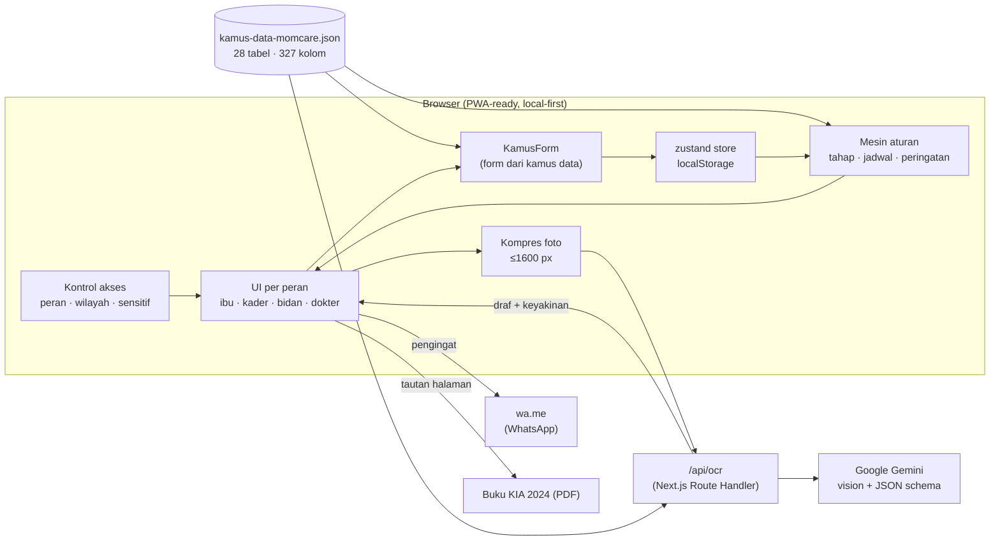

# MOMCARE: Buku KIA yang tidak berhenti di kertas

> Logicodix 2026 · Subtema **Inclusive Health & Well-being** · Tim **TUNG3SAHOOR**

MOMCARE adalah web app (MVP) yang mengubah isian **Buku KIA Kemenkes 2024** menjadi daftar tugas harian untuk kader, bidan, dan dokter. Tujuannya agar **tidak ada ibu hamil, ibu nifas, atau bayi baru lahir di wilayah posyandu yang terlewat**. Ibu melihat tampilan yang sederhana: sedang di tahap apa, apa yang perlu dilakukan hari ini, dan tanda bahaya. Kader/nakes melihat siapa yang **Merah** (hubungi hari ini), **Kuning** (cek kunjungan terdekat), dan **Hijau**.

- **Demo:** _isi URL deploy di sini_ (mis. `https://momcare-xxx.vercel.app`)
- **Video demo:** _opsional_

## Tim

| Nama | Peran |
| --- | --- |
| _isi nama_ | _mis. Product & riset_ |
| _isi nama_ | _mis. Frontend_ |
| _isi nama_ | _mis. Data & aturan klinis_ |

## Masalah

Buku KIA berisi jadwal kunjungan (K1–K6, KF1–KF4, KN1–KN3), lembar pemantauan, dan tanda bahaya, tetapi semuanya di kertas. Kader sulit tahu ibu mana yang terlambat periksa, hasil tekanan darah tinggi tidak langsung sampai ke bidan, dan keluarga sering tidak ikut diingatkan.

## Fitur utama

| Fitur | Untuk | Keterangan |
| --- | --- | --- |
| **Tahap otomatis** | semua | T1 ≤ 12 mgg, T2 > 12–24, T3 > 24, nifas 0–42 hari, bayi 0–28 hari. HPL dari USG T1 → dokter T1 → HPHT + 280 hari. |
| **Mesin peringatan Merah/Kuning** | kader, bidan, dokter | ±30 aturan dari Buku KIA & kamus data: TD ≥ 140/90, Hb, LiLA, DJJ, preeklamsia (hlm. 102), DM gestasional, tripel eliminasi, skrining jiwa, lembar pemantauan, nifas, neonatal, BBLR, warna tinja, rujukan tanpa rujukan balik, kunjungan terlambat. Setiap peringatan menautkan halaman Buku KIA. |
| **Jadwal kunjungan** | semua | K1–K6 (1× T1, 2× T2, 3× T3) + dokter T1/T3, skrining preeklamsia & DM, KF1–KF4, KN1–KN3. Status: selesai / jatuh tempo / terlambat. |
| **Foto Buku KIA → AI → konfirmasi** | kader, bidan | Foto dikompres di perangkat (≤ 1600 px), dibaca Gemini dengan **skema JSON dari kamus data**, nilai keyakinan per kolom (< 85 % diberi kotak kuning). Hasil **selalu draf** sampai dikonfirmasi; nama & waktu konfirmasi dicatat; foto dihapus setelahnya. |
| **Form dari kamus data** | semua | 28 tabel / 327 kolom → form, validasi rentang, pilihan, kolom wajib, isian otomatis (HPL, IMT, MAP, skor preeklamsia). |
| **Lembar pemantauan ibu** | ibu | Ceklis mingguan hamil, harian nifas, harian bayi, persiapan P4K, KB, warna tinja. |
| **Tindak lanjut & penutupan** | kader → bidan/dokter | Kader mencatat tindak lanjut (bila ibu menolak/tak bisa dihubungi → diteruskan ke bidan). **Hanya bidan/dokter yang bisa menutup peringatan.** |
| **Pengingat WhatsApp** | kader, bidan | H-2, H, H+2 dari tanggal kembali ke ibu **dan** suami/keluarga lewat tautan `wa.me` (tanpa biaya API). Pesan tidak berisi data sensitif. |
| **Grafik** | nakes, ibu | Kenaikan BB vs target IMT pra-hamil (hlm. 108), TFU & DJJ. |
| **Edukasi bergambar (flipbook)** | ibu | 13 "buku" per tahap (hamil T1–T3, P4K, melahirkan, nifas, menyusui, ASI perah, bayi baru lahir, perawatan bayi, kesehatan jiwa, KB) yang dibalik seperti buku: geser atau tombol Lanjut. Ilustrasi diambil dari Buku KIA 2024, bahasa disederhanakan, setiap lembar menyebut halaman bukunya. Tanda bahaya juga ditampilkan dengan gambar. |
| **Pantau bergambar** | ibu | Lembar pemantauan mingguan/harian memakai gambar kolom asli Buku KIA (hlm. 10–11, 28–31, 42–45): ibu cukup mengetuk gambar keluhan yang dialami, tanpa kotak centang. |
| **Catatan (Buku KIA Saya)** | ibu | Semua catatan ibu dikelompokkan per bab dengan warna mengikuti buku. Jadwal kunjungan dan grafik ada di halaman tersendiri supaya isi pemeriksaan tidak tampil dua kali. |

## Etika, privasi & keamanan

- **Persetujuan ibu wajib** sebelum data disimpan (teks dibacakan, saksi = kader/bidan yang login, versi teks dicatat).
- **NIK disimpan sebagai hash SHA-256**; yang ditampilkan hanya 4 digit terakhir.
- **Akses berbasis peran**: kader hanya melihat ibu di posyandunya; bidan sesuai wilayah kerja; dokter seluruh puskesmas; ibu hanya datanya sendiri dan **tidak bisa mengubah hasil pemeriksaan**.
- **Data sensitif** (tripel eliminasi HIV/sifilis/hepatitis B, skrining kesehatan jiwa) hanya terlihat oleh bidan/dokter, tidak diekstrak oleh OCR, dan tidak pernah ikut pesan WhatsApp ke keluarga.
- **AI tidak membuat keputusan klinis**: OCR hanya mengusulkan draf; keputusan peringatan berasal dari aturan yang dapat diaudit (`src/lib/aturan.ts`) dengan rujukan halaman Buku KIA.
- **Jejak audit**: setiap catatan menyimpan pembuat, sumber (ketik manual / foto OCR), siapa yang mengonfirmasi, dan riwayat perubahan.
- Kunci API hanya di server (`/api/ocr`), dibatasi ukuran gambar & laju permintaan.
- Semua data demo **fiktif**.

## Teknologi

- **Next.js 16** (App Router, Turbopack, Cache Components) · **React 19** · **TypeScript**
- **Tailwind CSS v4** · `motion` · `lucide-react` · `recharts` · `sonner` · Radix Dialog
- **zustand** (persist ke `localStorage`, *local-first*, tanpa backend berbayar)
- **Google Gemini** (`@google/genai`, structured output `responseJsonSchema`) untuk OCR tulisan tangan
- `date-fns` (locale `id`)

## Arsitektur



Struktur penting:

```
src/
  app/
    page.tsx               landing
    masuk/                 pemilih akun demo
    ibu/                   tampilan ibu (beranda, pantau, persiapan, hasil, edukasi, profil, kb)
    app/                   tampilan kader/bidan/dokter
      ibu/[id]/            detail ibu + isi/[tabel] (form generik)
      foto/                foto Buku KIA → OCR → konfirmasi
      daftar/              pendaftaran ibu (persetujuan → identitas → keluarga → kehamilan)
      pengingat/  kamus/
    api/ocr/route.ts       OCR Gemini (atau mode demo)
  lib/
    kamus.ts  aturan.ts  jadwal.ts  tahap.ts  skrining.ts  akses.ts  store.ts  seed.ts ...
  data/kamus-data-momcare.json, edukasi.ts (isi flipbook), gambar-kia.ts (daftar ilustrasi)
  components/ilustrasi.tsx  ikon bergambar buatan tim (SVG) untuk menu Fitur dan keadaan kosong
public/kia/                ilustrasi Buku KIA 2024 (WebP, ±1,4 MB total)
scripts/cek-aturan.ts      uji mesin peringatan terhadap data demo
```

## Menjalankan secara lokal

Prasyarat: Node.js ≥ 20.

```bash
git clone <repo-ini>
cd tung3sahoor
npm install
cp .env.example .env.local   # opsional: isi GEMINI_API_KEY
npm run dev                  # http://localhost:3000
```

Perintah lain:

```bash
npm run build && npm start   # build produksi
npm run lint                 # ESLint
npm run typecheck            # TypeScript
npm run cek                  # cetak hasil mesin peringatan untuk data demo
```

### Variabel lingkungan

| Nama | Wajib | Keterangan |
| --- | --- | --- |
| `GEMINI_API_KEY` | tidak | Tanpa kunci, fitur foto memakai **mode demo** (contoh hasil, ditandai jelas di layar). Kunci gratis dari Google AI Studio. |
| `GEMINI_MODEL` | tidak | Default `gemini-2.5-flash`. |

### Deploy (Vercel)

1. Import repo di Vercel → framework terdeteksi Next.js.
2. Tambahkan `GEMINI_API_KEY` (dan opsional `GEMINI_MODEL`) di *Environment Variables*.
3. Deploy. Tidak perlu database: data demo dibuat di browser setiap pengguna.

## Akun demo

Buka `/masuk` lalu pilih akun (tanpa kata sandi; data demo fiktif dan tersimpan di browser Anda). Tombol **Kembalikan data demo** mengatur ulang semuanya.

| Akun | Peran | Yang bisa dicoba |
| --- | --- | --- |
| **Siti Aminah** | Ibu, hamil 34 minggu | Beranda tahap, "Hari ini", banner Merah (TD 145/95 + protein), lembar pemantauan, persiapan P4K, hasil periksa |
| **Dewi Puspita** | Ibu, nifas hari ke-5 + bayi | Pemantauan nifas & bayi, KF/KN, warna tinja |
| **Rina Marlina** | Kader Posyandu Melati | Hanya melihat 4 ibu Melati; foto Buku KIA; catat tindak lanjut; WA pengingat; tidak melihat data sensitif |
| **Bidan Lestari Wulandari** | Bidan (Melati & Mawar) | Semua ibu wilayahnya, rujukan menunggu balik, tutup peringatan, skrining preeklamsia, daftarkan ibu |
| **dr. Andi Pratama** | Dokter puskesmas | Seluruh wilayah, pemeriksaan dokter T1/T3, skrining DM, rujukan |

Skenario data: Siti (Merah, TD tinggi; K5 diinput lewat foto), Rahma (Merah, risiko preeklamsia; anemia; skrining jiwa sensitif; rujukan tanpa balik), Fitri (Merah, gerak bayi berkurang; KEK), Dewi (Kuning, nifas), Nur (Kuning, K2 & skrining terlambat), Ayu & Lina (Hijau; Lina di Posyandu Anggrek, tidak terlihat oleh kader/bidan Melati).

## Penggunaan AI

| Di mana | AI | Untuk apa | Batasan |
| --- | --- | --- | --- |
| Fitur **Foto Buku KIA** (`src/app/api/ocr/route.ts`) | Google Gemini (default `gemini-2.5-flash`) | Membaca tulisan tangan di tabel K1–K6, KF, KN menjadi JSON sesuai kamus data + keyakinan per kolom | Hasil hanya draf; wajib dicek & dikonfirmasi kader/nakes; nilai di luar rentang wajar diturunkan keyakinannya; kolom sensitif tidak diekstrak |
| Pengembangan | Claude Code (Anthropic) | Membantu menelaah dokumen spesifikasi & Buku KIA, menulis kode, dan pengujian | Aturan klinis ditinjau tim terhadap Buku KIA & kamus data; keputusan desain tetap oleh tim |

Mesin peringatan **tidak** memakai AI: seluruhnya aturan deterministik yang dapat diaudit.

## Catatan & keterbatasan

- MVP ini *local-first*: data tersimpan di `localStorage` browser masing-masing. Untuk produksi, `store.ts` dapat diganti dengan backend (mis. Supabase/Postgres dengan Row Level Security yang mencerminkan `akses.ts`).
- Beberapa level peringatan mengikuti kamus data bila berbeda dengan bagian 5b spesifikasi (mis. BBLR dan tripel eliminasi reaktif = **Merah**).
- Aturan klinis adalah alat bantu skrining, bukan pengganti penilaian tenaga kesehatan.

## Atribusi

- **Buku Kesehatan Ibu dan Anak (KIA) 2024**, Kementerian Kesehatan RI: sumber isi tabel, jadwal, tanda bahaya, dan nomor halaman. Tautan PDF di aplikasi diarahkan ke salinan publik buku tersebut.
- Ilustrasi di `public/kia/` dipotong dari PDF Buku KIA 2024 (Kemenkes RI) untuk materi edukasi, tanda bahaya, lembar pemantauan, dan potret akun demo; hak cipta ilustrasi tetap milik Kemenkes RI dan sumbernya dicantumkan di aplikasi.
- Rekomendasi anemia kehamilan merujuk WHO (2024) sebagaimana dicantumkan di spesifikasi tim.
- Ikon: [Lucide](https://lucide.dev) (ISC). Font: Plus Jakarta Sans (SIL OFL) via `next/font`.
- Pustaka open-source: Next.js, React, Tailwind CSS, zustand, motion, recharts, sonner, Radix UI, date-fns, @google/genai (lisensi masing-masing).
