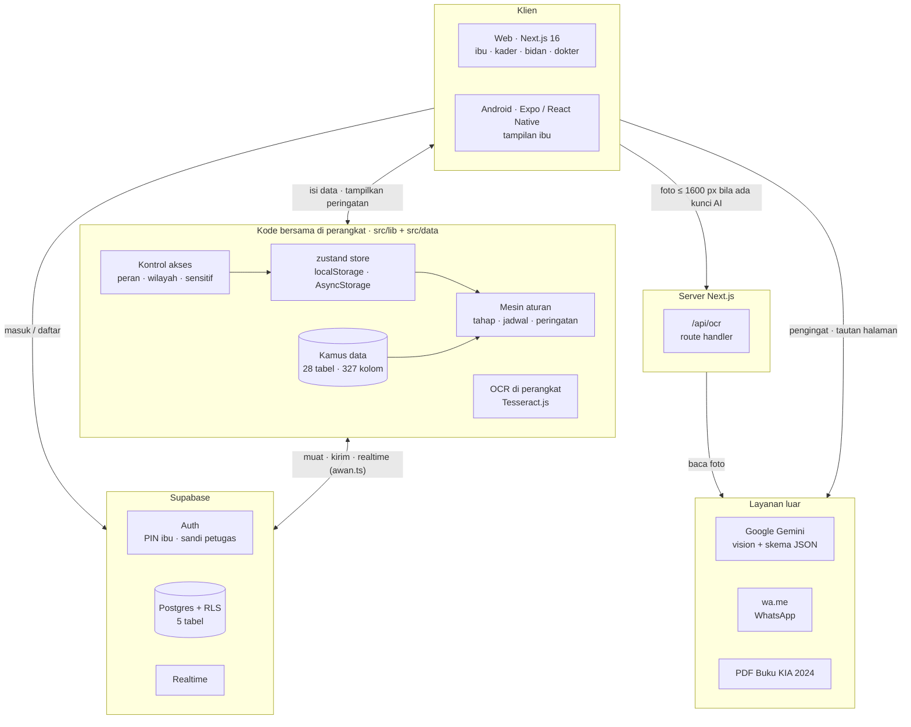
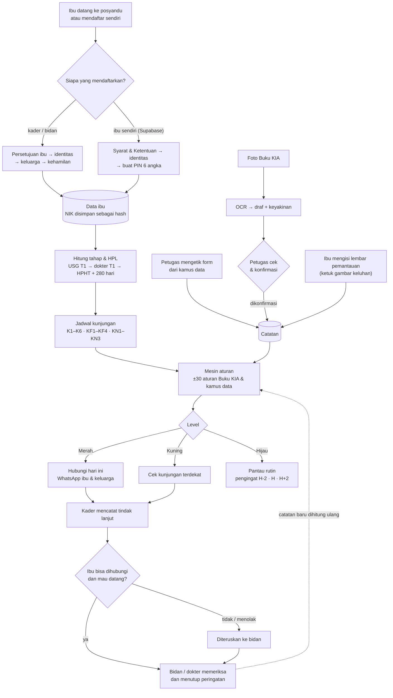
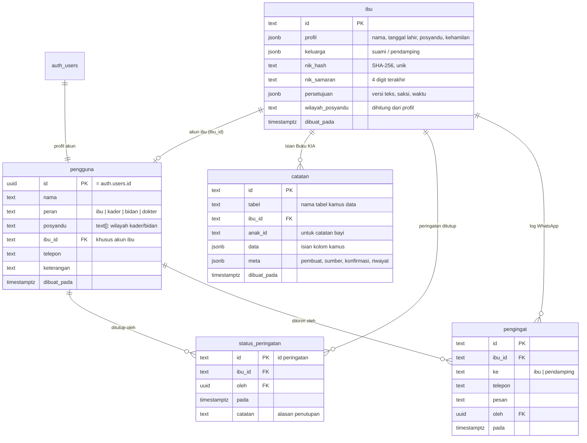

# Rangkul: Buku KIA yang tidak berhenti di kertas

> Logicodix 2026 · Subtema **Inclusive Health & Well-being** · Tim **TUNG3SAHOOR**

Rangkul (MVP) mengubah isian **Buku KIA Kemenkes 2024** menjadi daftar tugas harian untuk kader, bidan, dan dokter. Tujuannya agar **tidak ada ibu hamil, ibu nifas, atau bayi baru lahir di wilayah posyandu yang terlewat**. Rangkul terdiri dari dua aplikasi yang memakai aturan klinis yang sama:

- **Web** (Next.js, folder ini): kader dan nakes melihat siapa yang **Merah** (hubungi hari ini), **Kuning** (cek kunjungan terdekat), dan **Hijau**. Ibu juga bisa memakai tampilan sederhananya di web: sedang di tahap apa, apa yang perlu dilakukan hari ini, dan tanda bahaya.
- **Aplikasi Android Rangkul** (React Native/Expo, folder [`mobile/`](mobile/)): tampilan ibu yang sama sebagai aplikasi HP, termasuk buku bergambar yang dibalik seperti kertas.

- **Demo:** _isi URL deploy di sini_ (mis. `https://momcare-xxx.vercel.app`)
- **Video demo:** _opsional_

## Tim

| Nama | Peran |
| --- | --- |
| _isi nama_ | _mis. Product & riset_ |
| _isi nama_ | _mis. Frontend_ |
| _isi nama_ | _mis. Data & aturan klinis_ |

## Masalah

Buku KIA berisi jadwal kunjungan (K1–K6, KF1–KF4, KN1–KN3), lembar pemantauan, dan tanda bahaya, tetapi semuanya di kertas. Kader sulit tahu ibu mana yang terlambat periksa, hasil tekanan darah tinggi tidak langsung sampai ke bidan, dan keluarga sering tidak ikut diingatkan.

## Target pengguna

| Pengguna | Kebutuhan | Aplikasi |
| --- | --- | --- |
| **Ibu hamil, ibu nifas** (dan keluarganya) | Tahu sedang di tahap apa, apa yang perlu dilakukan hari ini, kapan periksa, dan tanda bahaya; mencatat keluhan tanpa banyak membaca | Aplikasi Android Rangkul atau web (`/ibu`) |
| **Kader posyandu** | Daftar ibu di posyandunya yang perlu dihubungi hari ini, mendaftarkan ibu, memindahkan isi Buku KIA (ketik atau foto), mengirim pengingat WhatsApp | Web (`/app`), dari HP atau laptop |
| **Bidan** | Semua ibu di wilayah kerjanya, hasil pemeriksaan & skrining, rujukan yang belum kembali, menutup peringatan | Web (`/app`) |
| **Dokter puskesmas** | Seluruh wilayah puskesmas, pemeriksaan dokter T1/T3, skrining DM, rujukan | Web (`/app`) |

Rangkul dirancang untuk posyandu di daerah dengan sinyal dan literasi yang beragam: tampilan ibu bergambar dengan kalimat pendek, dan web petugas serta aplikasi ibu memakai satu database bersama (Supabase), jadi isian ibu di HP langsung terlihat oleh bidan.

## Fitur utama

| Fitur | Untuk | Keterangan |
| --- | --- | --- |
| **Tahap otomatis** | semua | T1 ≤ 12 mgg, T2 > 12–24, T3 > 24, nifas 0–42 hari, bayi 0–28 hari. HPL dari USG T1 → dokter T1 → HPHT + 280 hari. |
| **Mesin peringatan Merah/Kuning** | kader, bidan, dokter | ±30 aturan dari Buku KIA & kamus data: TD ≥ 140/90, Hb, LiLA, DJJ, preeklamsia (hlm. 102), DM gestasional, tripel eliminasi, skrining jiwa, lembar pemantauan, nifas, neonatal, BBLR, warna tinja, rujukan tanpa rujukan balik, kunjungan terlambat. Setiap peringatan menautkan halaman Buku KIA. |
| **Jadwal kunjungan** | semua | K1–K6 (1× T1, 2× T2, 3× T3) + dokter T1/T3, skrining preeklamsia & DM, KF1–KF4, KN1–KN3. Status: selesai / jatuh tempo / terlambat. |
| **Foto Buku KIA → AI → konfirmasi** | kader, bidan | Foto dikompres di perangkat (≤ 1600 px), dibaca Gemini dengan **skema JSON dari kamus data**, nilai keyakinan per kolom (< 85 % diberi kotak kuning). Tanpa kunci Gemini, foto dibaca **di perangkat dengan Tesseract** (tidak dikirim ke server) dan semua isiannya ditandai untuk dicek. Hasil **selalu draf** sampai dikonfirmasi; nama & waktu konfirmasi dicatat; foto dihapus setelahnya. |
| **Form dari kamus data** | semua | 28 tabel / 327 kolom → form, validasi rentang, pilihan, kolom wajib, isian otomatis (HPL, IMT, MAP, skor preeklamsia). |
| **Lembar pemantauan ibu** | ibu | Ceklis mingguan hamil, harian nifas, harian bayi, persiapan P4K, KB, warna tinja. |
| **Tindak lanjut & penutupan** | kader → bidan/dokter | Kader mencatat tindak lanjut (bila ibu menolak/tak bisa dihubungi → diteruskan ke bidan). **Hanya bidan/dokter yang bisa menutup peringatan.** |
| **Pengingat WhatsApp** | kader, bidan | H-2, H, H+2 dari tanggal kembali ke ibu **dan** suami/keluarga lewat tautan `wa.me` (tanpa biaya API). Pesan tidak berisi data sensitif. |
| **Grafik** | nakes, ibu | Kenaikan BB vs target IMT pra-hamil (hlm. 108), TFU & DJJ. |
| **Edukasi bergambar (flipbook)** | ibu | 13 "buku" per tahap (hamil T1–T3, P4K, melahirkan, nifas, menyusui, ASI perah, bayi baru lahir, perawatan bayi, kesehatan jiwa, KB) yang dibalik seperti buku: geser atau tombol Lanjut. Ilustrasi diambil dari Buku KIA 2024, bahasa disederhanakan, setiap lembar menyebut halaman bukunya. Tanda bahaya juga ditampilkan dengan gambar. |
| **Pantau bergambar** | ibu | Lembar pemantauan mingguan/harian memakai gambar kolom asli Buku KIA (hlm. 10–11, 28–31, 42–45): ibu cukup mengetuk gambar keluhan yang dialami, tanpa kotak centang. |
| **Catatan (Buku KIA Saya)** | ibu | Semua catatan ibu dikelompokkan per bab dengan warna mengikuti buku. Jadwal kunjungan dan grafik ada di halaman tersendiri supaya isi pemeriksaan tidak tampil dua kali. |

## Etika, privasi & keamanan

- **Persetujuan ibu wajib** sebelum data disimpan (teks dibacakan, saksi = kader/bidan yang login, versi teks dicatat).
- **NIK disimpan sebagai hash SHA-256**; yang ditampilkan hanya 4 digit terakhir.
- **Akses berbasis peran**: kader hanya melihat ibu di posyandunya; bidan sesuai wilayah kerja; dokter seluruh puskesmas; ibu hanya datanya sendiri dan **tidak bisa mengubah hasil pemeriksaan**.
- **Data sensitif** (tripel eliminasi HIV/sifilis/hepatitis B, skrining kesehatan jiwa) hanya terlihat oleh bidan/dokter, tidak diekstrak oleh OCR, dan tidak pernah ikut pesan WhatsApp ke keluarga.
- **AI tidak membuat keputusan klinis**: OCR hanya mengusulkan draf; keputusan peringatan berasal dari aturan yang dapat diaudit (`src/lib/aturan.ts`) dengan rujukan halaman Buku KIA.
- **Jejak audit**: setiap catatan menyimpan pembuat, sumber (ketik manual / foto OCR), siapa yang mengonfirmasi, dan riwayat perubahan.
- Kunci API hanya di server (`/api/ocr`), dibatasi ukuran gambar & laju permintaan.
- Semua data demo **fiktif**.

## Teknologi

Aplikasi Ibu (`mobile/`): **Expo SDK 58** · **React Native 0.88** (New Architecture) · Expo Router · Reanimated 4 + Gesture Handler 3 (flipbook dihitung di thread UI) · react-native-svg (grafik & ilustrasi) · expo-image · AsyncStorage.

Web:

- **Next.js 16** (App Router, Turbopack, Cache Components) · **React 19** · **TypeScript**
- **Tailwind CSS v4** · `motion` · `lucide-react` · `recharts` · `sonner` · Radix Dialog
- **zustand** (cache lokal di `localStorage` / AsyncStorage)
- **Supabase** (opsional): Postgres + Row Level Security, Auth (PIN ibu / sandi petugas), Realtime; skema di `supabase/migrations/`
- **Google Gemini** (`@google/genai`, structured output `responseJsonSchema`) untuk OCR tulisan tangan
- **Tesseract.js** sebagai OCR cadangan di peramban bila `GEMINI_API_KEY` tidak diisi (baik untuk huruf cetak, lemah untuk tulisan tangan)
- `date-fns` (locale `id`)

## Arsitektur

Rangkul terdiri dari dua klien (web dan Android) yang memakai **kode logika yang sama** (`src/lib`, `src/data`), satu route handler Next.js untuk OCR, dan Supabase sebagai backend data yang bersifat opsional. Mesin aturan berjalan di perangkat pengguna, jadi peringatan tetap terhitung walau tanpa server.



| Lapisan | Isi | Keterangan |
| --- | --- | --- |
| Klien web | Next.js 16 (App Router), React 19 | Tampilan ibu (`/ibu`) dan petugas (`/app`). Komponen klien; data dibaca dari store di perangkat. |
| Klien Android | Expo SDK 58, React Native 0.88 | Tampilan ibu. Metro mengarahkan `@/lib` dan `@/data` ke `src/` web, jadi aturan klinis tidak disalin. |
| Logika bersama | `src/lib` | Mesin aturan, jadwal, tahap, skrining, hak akses, store, sinkronisasi Supabase. |
| Server | Route handler `/api/ocr` | Satu-satunya kode server. Menyimpan kunci Gemini, membatasi ukuran gambar dan laju permintaan. |
| Data | Supabase | Auth, Postgres dengan RLS yang meniru `akses.ts`, trigger pendaftaran, Realtime. Wajib: tanpa Supabase tidak ada akun yang bisa masuk. |
| Layanan luar | Google Gemini, wa.me, PDF Buku KIA | Gemini hanya membaca foto; WhatsApp lewat tautan `wa.me` tanpa API berbayar. |

### Alur program

Alur utama dari pendaftaran ibu sampai peringatan ditutup:



Peringatan tidak disimpan: setiap kali data berubah, mesin aturan menghitung ulang dari catatan. Yang disimpan hanya peringatan yang **sudah ditutup** bidan/dokter (`status_peringatan`).

## Dokumentasi frontend

### Framework & pustaka

| | Web (`/`) | Aplikasi Android (`mobile/`) |
| --- | --- | --- |
| Framework | Next.js 16 (App Router, Turbopack), React 19, TypeScript | Expo SDK 58, React Native 0.88 (New Architecture), Expo Router, TypeScript |
| Tampilan | Tailwind CSS v4, Radix Dialog, `motion`, `lucide-react` | Gaya inline + token warna di `mobile/src/tema.ts`, `lucide-react-native` |
| Grafik | `recharts` | `react-native-svg` |
| Animasi flipbook | `motion` | Reanimated 4 + Gesture Handler 3 (dihitung di thread UI) |
| State & data | zustand (`src/lib/store.ts`), `@supabase/supabase-js` | Store yang sama (dibagikan lewat alias `@/`) |
| Penyimpanan lokal | `localStorage` (`src/lib/penyimpanan.ts`) | AsyncStorage (`src/lib/penyimpanan.native.ts`) |

### Halaman

| Rute web | Untuk | Isi |
| --- | --- | --- |
| `/` | umum | Landing |
| `/masuk`, `/daftar` | semua | Masuk (pilih akun demo, atau PIN/sandi bila Supabase aktif) dan pendaftaran akun |
| `/ibu` | ibu | Beranda: banner peringatan, tahap kehamilan, "Hari ini", hasil periksa terakhir |
| `/ibu/fitur`, `/ibu/pantau`, `/ibu/persiapan`, `/ibu/hasil`, `/ibu/kb`, `/ibu/catatan` | ibu | Menu fitur, lembar pemantauan bergambar, persiapan P4K, jadwal & grafik, KB, Buku KIA Saya |
| `/ibu/edukasi`, `/ibu/edukasi/[slug]` | ibu | Rak buku edukasi dan flipbook |
| `/ibu/tanda-bahaya`, `/ibu/profil/*` | ibu | Tanda bahaya bergambar; profil, keluarga, privasi, tentang |
| `/app` | kader, bidan, dokter | Daftar tugas: ibu Merah, Kuning, Hijau |
| `/app/ibu`, `/app/ibu/[id]`, `/app/ibu/[id]/isi/[tabel]` | petugas | Daftar ibu, detail ibu (ringkasan klinis, peringatan, riwayat), form isian per tabel kamus |
| `/app/daftar` | kader, bidan | Pendaftaran ibu: persetujuan → identitas → keluarga → kehamilan |
| `/app/foto` | kader, bidan | Foto Buku KIA → OCR → konfirmasi |
| `/app/pengingat`, `/app/kamus` | petugas | Pengingat WhatsApp; kamus data |

Aplikasi Android memiliki layar ibu yang sama di `mobile/src/app/` (Expo Router): `masuk`, `daftar`, `ibu/(tab)` (beranda, fitur, catatan, profil), `ibu/pantau`, `persiapan`, `hasil`, `kb`, `tanda-bahaya`, `edukasi`, `profil/*`.

### Komponen UI

| Komponen web (`src/components/`) | Padanan Android (`mobile/src/ui/`) | Fungsi |
| --- | --- | --- |
| `ui.tsx`: `Tombol`, `Kartu`, `Modal`, `Tab`, `Masukan`, `Pilihan`, `Lencana`, `Memuat`, `Kosong` | `dasar.tsx`: `Tombol`, `Kartu`, `LembarBawah`, `Tab`, `Lencana`, `Layar`, `Kepala`, `Memuat`, `Kosong` | Komponen dasar dan tata letak |
| `kamus-form.tsx`: `KamusForm`, `TampilCatatan` | `catatan.tsx`: `TampilCatatan` | Form otomatis dari kamus data (validasi rentang, pilihan, kolom wajib, isian otomatis) dan tampilan catatan |
| `peringatan.tsx`: `DaftarPeringatan`, `ItemPeringatan` | (banner di beranda) | Peringatan Merah/Kuning dengan tautan halaman Buku KIA |
| `baris-ibu.tsx`: `BarisIbu`, `KotakDaftar` | – | Baris ibu di daftar tugas petugas |
| `tahap.tsx`: `KartuTahap`, `DaftarJadwal` | `tahap.tsx` | Usia kehamilan, ukuran bayi, jadwal kunjungan |
| `grafik.tsx`: `GrafikBB`, `GrafikTfuDjj` | `grafik.tsx` | Kenaikan BB vs target IMT, TFU & DJJ |
| `riwayat.tsx`: `RiwayatTabel` | – | Riwayat pemeriksaan dengan nilai di luar batas ditandai |
| `tombol-wa.tsx`: `TombolWa` | – | Pesan WhatsApp sesuai status ibu |
| `flipbook.tsx`, `lembar-materi.tsx` | `flipbook.tsx`, `lembar-materi.tsx` | Buku edukasi yang dibalik seperti kertas |
| `akun.tsx`: `PapanPin`, `IsianTelepon`, `IsianSandi`, `IsiSyarat` | `akun.tsx`, `masuk-awan.tsx` | Masuk dan daftar akun |
| `sos.tsx`: `TombolSos` | `sos.tsx` | Jalan pintas 119 dan tanda bahaya |
| `gambar-kia.tsx`, `ilustrasi.tsx` | `gambar.tsx`, `ilustrasi.tsx` | Ilustrasi Buku KIA dan ikon bergambar |
| `logo.tsx`: `LogoMark`, `Logo` | `dasar.tsx`: `LogoMark` | Logo Rangkul |
| `kepala.tsx`, `pelapor-galat.tsx` | – | Judul halaman; toast galat sinkronisasi Supabase |

### Aset

- `public/kia/`: ±150 ilustrasi Buku KIA 2024 (WebP, ±1,4 MB total), dipakai web dan dipaketkan ke aplikasi Android (`mobile/src/ui/sumber-gambar.ts`, dibuat oleh `mobile/scripts/daftar-gambar.mjs`).
- `src/components/ilustrasi.tsx`: ikon bergambar buatan tim (SVG).
- `mobile/assets/`: ikon aplikasi, ikon adaptif & monokrom Android, splash.
- Font Plus Jakarta Sans (`next/font`), ikon Lucide.

### Struktur folder

```
src/
  app/
    page.tsx               landing
    masuk/                 masuk (akun demo atau Supabase: awan.tsx)
    daftar/                pendaftaran akun ibu & petugas (Supabase)
    ibu/                   tampilan ibu (beranda, pantau, persiapan, hasil, edukasi, profil, kb)
    app/                   tampilan kader/bidan/dokter
      ibu/[id]/            detail ibu + isi/[tabel] (form generik)
      foto/                foto Buku KIA → OCR → konfirmasi
      daftar/              pendaftaran ibu oleh petugas
      pengingat/  kamus/
    api/ocr/route.ts       OCR Gemini (GET mesin, POST baca foto)
  components/              komponen UI web (lihat tabel di atas)
  lib/                     dipakai bersama oleh web dan aplikasi Android
    aturan.ts              mesin peringatan dini (±30 aturan)
    jadwal.ts  tahap.ts  skrining.ts  tugas.ts  pengingat.ts  pesan.ts
    akses.ts               hak akses per peran
    kamus.ts  formulir.ts  validasi & tata letak form dari kamus data
    store.ts               state aplikasi (zustand) + sinkron awan
    awan.ts                sinkronisasi ke Supabase (muat, kirim, realtime)
    akun.ts                masuk & daftar lewat Supabase Auth
    supabase.ts / .native.ts      klien Supabase (web / Android)
    penyimpanan.ts / .native.ts   localStorage di web, AsyncStorage di Android
    ocr-lokal.ts  gambar.ts       OCR Tesseract di perangkat, kompres foto
    seed.ts                data demo (fiktif)
  data/kamus-data-momcare.json, edukasi.ts (isi flipbook), gambar-kia.ts (daftar ilustrasi)
public/kia/                ilustrasi Buku KIA 2024 (WebP)
supabase/migrations/       skema database, RLS, trigger, realtime
scripts/
  cek-aturan.ts            uji mesin peringatan terhadap data demo
  seed-supabase.ts         membuat akun & data contoh di Supabase
mobile/                    aplikasi Android Rangkul (Expo)
  src/app/                 layar (Expo Router)
  src/ui/                  komponen native (lihat tabel di atas)
  metro.config.js          alias @/ → ../src supaya aturan klinis tidak disalin
  scripts/build-apk.mjs    membuat APK rilis di komputer sendiri
  plugins/cmake-baru.js    plugin Expo: CMake 3.31 untuk semua modul native (jalur panjang di Windows)
```

## Dokumentasi backend

Backend Rangkul terdiri dari **satu route handler Next.js** (OCR) dan **Supabase** (Auth, database, realtime). Klien membaca dan menulis tabel Supabase langsung lewat `@supabase/supabase-js`; hak akses dijaga Row Level Security di database, bukan di server aplikasi.

### API endpoint

| Metode & jalur | Fungsi | Permintaan | Respons |
| --- | --- | --- | --- |
| `GET /api/ocr` | Menanyakan mesin OCR yang tersedia sebelum foto dikirim | – | `200 { "mesin": "gemini" }` bila `GEMINI_API_KEY` diisi, selain itu `{ "mesin": "perangkat" }` (foto dibaca Tesseract di peramban dan tidak dikirim) |
| `POST /api/ocr` | Membaca foto satu tabel Buku KIA menjadi draf isian | JSON `{ "tabel": "anc" \| "kf" \| "kn", "gambar": "data:image/jpeg;base64,…", "kunjungan": "5" }` | `200 { "mode": "gemini", "model": "…", "hasil": { kolom: nilai }, "yakin": { kolom: 0–1 } }` |

Kode galat `POST /api/ocr` (badan respons `{ "pesan": "…" }`):

| Kode | Arti |
| --- | --- |
| `400` | JSON tidak valid, tabel tidak didukung, atau gambar bukan JPEG/PNG/WebP |
| `413` | Gambar lebih dari 6 MB |
| `429` | Lebih dari 12 permintaan per menit dari alamat IP yang sama |
| `503` | Server tidak punya kunci Gemini: klien membaca foto di perangkat |
| `502` | Gemini gagal: klien membaca foto di perangkat |

Hasil OCR dibersihkan di server: hanya kolom kamus data tabel itu yang diterima, nilai di luar rentang wajar diturunkan keyakinannya, dan kolom sensitif tidak diekstrak.

**Operasi data lewat Supabase** (dipanggil dari `src/lib/awan.ts` dan `src/lib/akun.ts`):

| Operasi | Pemanggilan | Keterangan |
| --- | --- | --- |
| Daftar akun | `supabase.auth.signUp` dengan data diri di `user_metadata` | Trigger membuat baris `pengguna` (dan `ibu`) dalam transaksi yang sama |
| Masuk | `supabase.auth.signInWithPassword` | Ibu: nomor HP (diubah ke `628…@hp.momcare.app`) atau email + PIN; petugas: email + sandi |
| Muat data | `select` dari `pengguna`, `ibu`, `catatan`, `status_peringatan`, `pengingat` | RLS hanya mengembalikan baris yang boleh dilihat akun itu |
| Simpan | `insert` / `update` ke `ibu`, `catatan`; `insert` / `delete` di `status_peringatan`; `insert` ke `pengingat` | Dikirim di latar belakang; galat ditampilkan sebagai toast |
| Realtime | Kanal `postgres_changes` untuk `ibu`, `catatan`, `status_peringatan`, `pengguna` | Isian ibu di HP langsung muncul di web petugas |

### Skema database

Skema lengkap: [`supabase/migrations/20261114000000_momcare_awal.sql`](supabase/migrations/20261114000000_momcare_awal.sql). Isian 28 tabel kamus data disimpan sebagai `jsonb` di tabel `catatan`, jadi tabel kamus tidak perlu dibuat satu per satu.



**Row Level Security** (meniru `src/lib/akses.ts`; akun anonim tidak bisa membaca apa pun):

| Tabel | Lihat | Tulis |
| --- | --- | --- |
| `ibu` | Kader: posyandunya · bidan: wilayah kerjanya · dokter: semua · ibu: dirinya | Kader/bidan mendaftarkan dan mengubah ibu di wilayahnya |
| `catatan` | Sama dengan `ibu` | Hanya tabel yang boleh diisi peran itu (`boleh_isi`); `meta.dibuat_oleh` harus akun yang masuk; ibu tidak bisa menyimpan hasil foto OCR |
| `status_peringatan` | Sama dengan `ibu` | Hanya bidan/dokter yang bisa menutup dan membuka lagi peringatan |
| `pengingat` | Petugas yang boleh melihat ibu itu | Petugas, atas nama dirinya sendiri |
| `pengguna` | Nama petugas terlihat semua akun; akun ibu hanya oleh dirinya dan petugas wilayahnya | Hanya dibuat oleh trigger pendaftaran |

**Trigger pendaftaran** (di `auth.users`):

1. `saring_nik_pendaftar` (sebelum insert): NIK mentah diganti hash SHA-256 dan samaran 4 digit, sehingga NIK asli tidak pernah tersimpan.
2. `buat_pengguna_baru` (setelah insert): membuat baris `pengguna`. Akun ibu ditautkan ke data yang sudah didaftarkan kader bila NIK dan tanggal lahirnya sama; bila belum ada, dibuatkan data ibu baru.

### `.env.example`

Semua variabel ada di [`.env.example`](.env.example) (web) dan [`mobile/.env.example`](mobile/.env.example) (Android); penjelasannya di bagian [Variabel lingkungan](#variabel-lingkungan). Kunci Supabase wajib agar bisa masuk; kunci Gemini opsional (tanpa itu foto dibaca di perangkat).

## Menjalankan secara lokal

Prasyarat: **Node.js ≥ 20** (disarankan LTS terbaru), **Git**, dan proyek **Supabase** (paket gratis cukup). Rangkul tidak punya akun demo tanpa sandi: semua akun masuk dengan PIN (ibu) atau kata sandi (petugas) yang tersimpan di Supabase. Kunci Gemini tidak wajib.

1. Unduh kode dan pasang dependensi:

   ```bash
   git clone <repo-ini>
   cd tung3sahoor
   npm install
   ```

2. Salin berkas variabel lingkungan, lalu isi kunci Supabase (wajib) dan `GEMINI_API_KEY` (opsional):

   ```bash
   cp .env.example .env.local          # macOS, Linux, Git Bash
   copy .env.example .env.local        # Windows Command Prompt
   Copy-Item .env.example .env.local   # Windows PowerShell
   ```

3. Siapkan database dan data contoh: ikuti langkah 1–5 di [Menyambungkan ke Supabase](#menyambungkan-ke-supabase-data-bersama-web--android) (jalankan SQL migrasi, matikan *Confirm email*, salin kunci, lalu `npm run seed:supabase`).

4. Jalankan server pengembangan dan buka http://localhost:3000:

   ```bash
   npm run dev
   ```

5. Buka `/masuk` dan masuk dengan akun contoh (lihat [Akun demo](#akun-demo)), atau buat akun baru lewat **Daftar**.

Perintah lain:

```bash
npm run build && npm start   # build produksi
npm run lint                 # ESLint
npm run typecheck            # TypeScript
npm run cek                  # cetak hasil mesin peringatan untuk data demo
```

### Aplikasi Android (Rangkul)

```bash
cd mobile
npm install
cp .env.example .env         # isi kunci Supabase (Windows: copy .env.example .env)
npx expo start               # pindai QR dengan Expo Go di HP Android, atau tekan "a" untuk emulator
npm run typecheck && npm run lint
```

HP dan laptop harus berada di jaringan Wi-Fi yang sama agar Expo Go bisa memuat aplikasi.

Membuat APK untuk dibagikan (butuh Android SDK dan JDK 17+; di Windows JDK bawaan Android Studio dipakai otomatis):

```bash
cd mobile
npm run build:apk            # hasil: mobile/dist/rangkul.apk
```

APK ditandatangani dengan kunci debug: cukup untuk demo dan dipasang langsung, bukan untuk Play Store (untuk itu pakai EAS Build). Folder `mobile/android/` dibuat ulang dari `app.json` saat build dan tidak disimpan di git. Kode native hanya dikompilasi untuk arm64 (ponsel); untuk emulator tambahkan `x86_64` lewat `ARSITEKTUR=arm64-v8a,x86_64`.

Catatan Windows: kode C++ New Architecture menghasilkan jalur berkas di atas 260 karakter, jadi build butuh:

- CMake **3.31.6** di Android SDK (Android Studio → SDK Manager → SDK Tools → centang *Show Package Details* → CMake 3.31.6). Ninja di CMake 3.22 bawaan belum mendukung jalur panjang; plugin `mobile/plugins/cmake-baru.js` memaksa semua modul memakai 3.31.6.
- Jalur panjang aktif di Windows (`LongPathsEnabled = 1`, lihat dokumentasi Microsoft "Maximum Path Length Limitation").
- Bila proyek berada di folder yang dalam, skrip menyalin `mobile/`, `src/`, dan `public/kia/` ke `C:\mi` (ganti lewat `FOLDER_BUILD`) dan membangun di sana; salinan berikutnya hanya memperbarui yang berubah. Sediakan ruang disk ±10 GB untuk build pertama (NDK, CMake, dan hasil kompilasi).

### Variabel lingkungan

| Nama | Wajib | Keterangan |
| --- | --- | --- |
| `GEMINI_API_KEY` | tidak | Tanpa kunci, foto Buku KIA dibaca di perangkat dengan Tesseract. Kunci gratis dari Google AI Studio. |
| `GEMINI_MODEL` | tidak | Default `gemini-3.8-flash`. |
| `NEXT_PUBLIC_URL_APK` | tidak | Tautan unduhan APK Rangkul; bila diisi, tautan unduh muncul di tab Ibu pada layar masuk. |
| `NEXT_PUBLIC_SUPABASE_URL`, `NEXT_PUBLIC_SUPABASE_PUBLISHABLE_KEY` | **ya** | Sambungan ke Supabase (lihat di bawah). Kosong = tidak ada akun yang bisa masuk. |
| `SUPABASE_SECRET_KEY` | tidak | Hanya untuk `npm run seed:supabase` di komputer sendiri. Jangan diisi di Vercel. |
| `EXPO_PUBLIC_SUPABASE_URL`, `EXPO_PUBLIC_SUPABASE_PUBLISHABLE_KEY` | **ya** (Android) | Di `mobile/.env`, nilai sama dengan versi web, agar aplikasi Android tersambung. |

### Menyambungkan ke Supabase (data bersama web + Android)

Data ibu, catatan, dan status peringatan tersimpan di satu database: isian ibu di HP langsung muncul di web petugas (realtime), dan akun dibuat lewat layar **Daftar**:

- **Ibu**: Syarat & Ketentuan → Lengkapi Identitas Diri (nomor HP atau email, nama, NIK, tanggal lahir, posyandu) → **buat PIN 6 angka** → konfirmasi PIN. Masuk berikutnya: nomor HP/email lalu PIN. Bila kader sudah mendaftarkan ibu dengan NIK + tanggal lahir yang sama, akun langsung tertaut ke data itu.
- **Kader / bidan / dokter** (web): Syarat & Ketentuan → nama, email, peran, posyandu, **kata sandi** (min. 8 karakter, huruf + angka).

Langkah:

1. Buat proyek di [supabase.com](https://supabase.com) (paket gratis cukup).
2. **SQL Editor** → tempel isi `supabase/migrations/20261114000000_momcare_awal.sql` → *Run*. Ini membuat tabel, Row Level Security yang meniru `src/lib/akses.ts`, trigger pendaftaran (NIK langsung disandikan SHA-256 di database), dan realtime.
3. **Authentication → Sign In / Providers → Email**: matikan **Confirm email**. Akun ibu yang memakai nomor HP disimpan sebagai `628…@hp.momcare.app` (Supabase butuh layanan SMS berbayar untuk login nomor HP), jadi tidak ada email konfirmasi yang bisa diterima.
4. **Project Settings → API Keys**: salin URL proyek dan *publishable key* ke `.env.local` (`NEXT_PUBLIC_SUPABASE_URL`, `NEXT_PUBLIC_SUPABASE_PUBLISHABLE_KEY`) dan ke `mobile/.env` (`EXPO_PUBLIC_…`). Salin juga *secret key* ke `SUPABASE_SECRET_KEY` di `.env.local`.
5. `npm run seed:supabase` untuk membuat data contoh kecil (2 ibu, 2 petugas; lihat tabel akun di bawah). Bisa dijalankan ulang untuk mengembalikan data contoh.
6. Jalankan ulang `npm run dev` / `npx expo start`. Untuk Vercel, tambahkan dua variabel `NEXT_PUBLIC_SUPABASE_*` lalu deploy ulang.

### Deploy (Vercel)

1. Import repo di Vercel → framework terdeteksi Next.js.
2. Tambahkan `GEMINI_API_KEY` (dan opsional `GEMINI_MODEL`) di *Environment Variables*.
3. Tambahkan `NEXT_PUBLIC_SUPABASE_URL` dan `NEXT_PUBLIC_SUPABASE_PUBLISHABLE_KEY` (wajib, tanpa keduanya tidak ada yang bisa masuk).
4. Deploy.

## Akun demo

Setelah `npm run seed:supabase` (semua data fiktif):

| Akun | Peran | Masuk dengan |
| --- | --- | --- |
| **Siti Aminah** | Ibu, hamil 34 minggu (Merah: TD tinggi) | Telepon `081200000001`, PIN `246810` |
| **Dewi Puspita** | Ibu, nifas + bayi | Telepon `081200000003`, PIN `246810` |
| **Bidan Lestari Wulandari** | Bidan, Posyandu Melati & Mawar | `bidan@momcare.test`, sandi `Momcare2026` |
| **Rina Marlina** | Kader Posyandu Melati | `kader@momcare.test`, sandi `Momcare2026` |

Pemeriksaan dokter di data contoh dicatat atas nama bidan karena belum ada akun dokter; daftarkan dokter lewat layar **Daftar**. Tanggal data contoh dihitung saat skrip dijalankan, jadi jalankan ulang skrip bila usia kehamilan sudah tidak cocok.

## Penggunaan AI

| Di mana | AI | Untuk apa | Batasan |
| --- | --- | --- | --- |
| Fitur **Foto Buku KIA** (`src/app/api/ocr/route.ts`) | Google Gemini (default `gemini-3.8-flash`) | Membaca tulisan tangan di tabel K1–K6, KF, KN menjadi JSON sesuai kamus data + keyakinan per kolom | Hasil hanya draf; wajib dicek & dikonfirmasi kader/nakes; nilai di luar rentang wajar diturunkan keyakinannya; kolom sensitif tidak diekstrak |
| Pengembangan | Claude Code (Anthropic) | Membantu menelaah dokumen spesifikasi & Buku KIA, menulis kode, dan pengujian | Aturan klinis ditinjau tim terhadap Buku KIA & kamus data; keputusan desain tetap oleh tim |

Mesin peringatan **tidak** memakai AI: seluruhnya aturan deterministik yang dapat diaudit.

## Catatan & keterbatasan

- Tanpa Supabase, data tersimpan di `localStorage` browser (web) dan AsyncStorage HP (aplikasi Ibu) dan **tidak saling tersambung**. Dengan Supabase, keduanya memakai database yang sama (`src/lib/awan.ts`); draf foto OCR tetap hanya di perangkat yang memotret.
- Siapa pun bisa mendaftar sebagai kader/bidan/dokter dan langsung melihat ibu di wilayah yang dipilihnya. Sebelum dipakai sungguhan, tambahkan persetujuan admin atau kode pendaftaran puskesmas.
- Kolom sensitif (tripel eliminasi, kesehatan jiwa) disembunyikan dari kader di aplikasi, tetapi RLS menyaring per baris, bukan per kolom: kader yang memanggil API langsung masih bisa membacanya. Untuk produksi, pisahkan kolom sensitif ke tabel sendiri.
- Lupa PIN/kata sandi belum ada di aplikasi; admin dapat mengatur ulang lewat dasbor Supabase (Authentication → Users).
- Beberapa level peringatan mengikuti kamus data bila berbeda dengan bagian 5b spesifikasi (mis. BBLR dan tripel eliminasi reaktif = **Merah**).
- Aturan klinis adalah alat bantu skrining, bukan pengganti penilaian tenaga kesehatan.

## Atribusi

- **Buku Kesehatan Ibu dan Anak (KIA) 2024**, Kementerian Kesehatan RI: sumber isi tabel, jadwal, tanda bahaya, dan nomor halaman. Tautan PDF di aplikasi diarahkan ke salinan publik buku tersebut.
- Ilustrasi di `public/kia/` dipotong dari PDF Buku KIA 2024 (Kemenkes RI) untuk materi edukasi, tanda bahaya, lembar pemantauan, dan potret akun demo; hak cipta ilustrasi tetap milik Kemenkes RI dan sumbernya dicantumkan di aplikasi.
- Rekomendasi anemia kehamilan merujuk WHO (2024) sebagaimana dicantumkan di spesifikasi tim.
- Ikon: [Lucide](https://lucide.dev) (ISC). Font: Plus Jakarta Sans (SIL OFL) via `next/font`.
- Pustaka open-source: Expo, React Native, Reanimated, Gesture Handler, react-native-svg, Next.js, React, Tailwind CSS, zustand, motion, recharts, sonner, Radix UI, date-fns, @google/genai (lisensi masing-masing).
